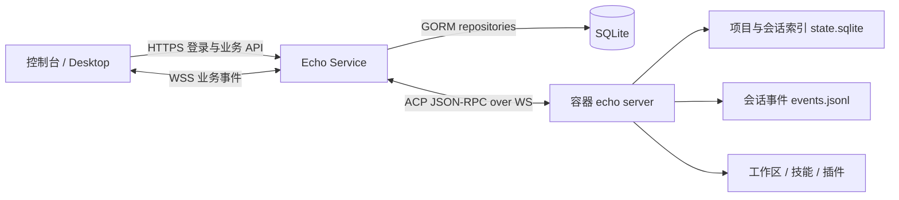

# Echo Service Demo 接口与数据规划 v1

状态：完整目标设计。当前已实现合同以 [当前接口](api-current.md) 为准，下文还包含后续扩展方向。
日期：2026-11-05。

## 1. 范围与结论

Echo Service 是控制台后端，同时代理到数据库登记的容器 `ws://ip:port/`。
本版使用 Go 1.24.3、现有 server-go/Gin/Viper/GORM，业务数据库改为 SQLite。
先实现单进程 Demo，保留 repository 边界，后续迁移 PostgreSQL 时不改变对外接口。

核心原则：

1. 用户登录、token、RBAC、容器登记和用户容器关系归 Go 服务。
2. 容器运行 `echo server`，项目、会话、消息执行、技能、插件和运行时设置归 Echo CLI。
3. 客户端只提交 `containerId` 或平台资源 ID；服务端查库决定地址，不能提交任意 WebSocket URL。
4. 普通查询/管理使用 HTTP JSON；消息执行使用异步 turn + WebSocket 事件，不能用一个阻塞 HTTP 请求等待模型完成。
5. 不提供任意 ACP 方法透传接口；逐接口校验、鉴权、转换和脱敏。
6. Demo 不包含自动创建容器、Kubernetes 编排、计费、多租户组织体系或跨容器迁移。
7. 首期一个容器同时只允许一个普通用户处于 active 分配状态。关系表支持未来多对多，但共享执行要等运行时隔离能力完成。



本服务的容器 WS 路径是用户本次指定的新服务端链路，不要求修改已有桌面本地 ACP stdio 链路。

## 2. 已核对的 CLI 能力与边界

事实来源是 `/Users/chengxi/Documents/workspace/aigc/echo-cli-rs` 当前源码，而非按通用 ACP 猜字段：

| 范围 | 源码 / wire test | 已确认行为 |
| --- | --- | --- |
| 容器 Agent 服务 | `crates/echo-server/src/server.rs` | `echo server --listen ws://0.0.0.0:4600`，文本帧承载 JSON-RPC，`/readyz`、`/healthz`；拒绝携带 Origin 的请求 |
| 项目 | `crates/echo-acp/src/ext/project.rs`、`crates/echo-core/src/project.rs` | `_project/list/read/create/update/move/delete`；roots 是有序 `{path}` 数组；创建要求 idempotencyKey |
| 会话 | `crates/echo-bin/tests/acp_stdio.rs`、`crates/echo-acp/src/ext/session.rs` | `session/new/list/load/prompt/cancel/set_model/set_mode/fork`、`_rename_session`、`_delete_session` |
| 会话恢复 | `README.md`、server tests | load 回放历史；不会把旧连接上的在途更新和审批自动转移到新连接 |
| 技能 | `crates/echo-acp/src/ext/skill.rs` | `_list_skills` 支持 scope、cwd，目录技能列表主动排除插件技能 |
| 插件 | `crates/echo-acp/src/ext/plugins.rs` | 已安装、目录、详情、安装、卸载、启停；部分参数使用 snake_case |
| 模型/设置 | `ext/model.rs`、`ext/settings.rs` | `_list_models`、`_refresh_models`、`_get_common_settings`、`_edit_common_settings` |
| 文件列表 | `ext/host_environment.rs` | `_fs/readDirectory` 返回直接子项，不是递归文件树 |
| 工具审批 | `crates/echo-bin/tests/acp_stdio.rs` | `session/request_permission` 是容器发向客户端的 JSON-RPC request，需要在原连接上回复对应 id |

特别注意：

- `echo exec-server` 是执行层，不是完整 Agent 项目/会话服务；本版不接错入口。
- 当前 `echo server` 原生监听只接受 `ws://SocketAddr`；未来 `wss://` 应由受信任的 TLS 终端提供，不能假设 CLI 已原生实现 TLS。
- CLI 现有 OAuth 登录与平台本地用户登录不是同一套身份。平台 access token 不直接写入容器 auth.json，不作为模型供应商凭据。
- `_get_common_settings` 包含 OAuth、同步等宿主级设置，不能整包开放给普通用户修改。
- CLI 支持 computer 路由。此服务直接连接目标容器，不再传入客户端指定的 computerId、远程 host 或 runtime 路由元数据。
- 会话 `projectId` 是归属；`runtimeWorkspaceRoots` 是执行目录范围；两者不能混为一谈。
- 当前目录扩展不能据此推导文件正文、上传、删除、搜索或 diff API 已存在。缺失能力明确标记为后续适配。

## 3. 登录、token 与权限

### 3.1 身份方案

Demo 使用本地账号密码 + 不透明随机 token，而不是自行设计 JWT 签名体系。
原因：只有一个鉴权服务，查表即可撤销 token、禁用用户和即时回收容器权限；以后可替换为 OIDC。

- 密码：Argon2id，独立随机盐，参数随 hash 保存；初始参数至少 19 MiB 内存、2 次迭代、并行度 1，按部署机器压测调整。
- access token：安全随机至少 256 bit，默认 30 分钟有效。
- refresh token：独立随机至少 256 bit，默认 7 天有效；每次刷新旋转，检测旧 refresh 重放时撤销整个登录会话族。
- SQLite 只存 token 的 SHA-256 摘要，不存原始 token；密码只存 hash。
- 每个设备登录对应一个 auth_session，允许列出和撤销设备登录。
- 无开放注册。首个管理员通过一次性 CLI 命令创建，交互输入密码；禁止默认管理员密码。
- 登录限流：按来源和标准化账号共同限速；错误统一为 InvalidCredentials，不区分账号不存在/密码错误。
- 修改密码、禁用账号、撤销登录立即使相应 access/refresh 失效，并关闭对应客户端 WS；撤销用户容器关系立即切断该范围的订阅与控制。
- `/me` 返回数据库中的最新用户、平台角色及有效权限，而非解析客户端自报身份。

### 3.2 客户端携带方式

HTTP API 使用 `Authorization: Bearer <accessToken>`。不在 URL query 中传长期 access token。

浏览器控制台：refresh token 放 HttpOnly、Secure、SameSite=Strict 的限定 Path Cookie（仅 auth 刷新/退出路由）；access token 放内存，刷新/退出检查 Origin 并使用 CSRF 防护。
Electron 原生桥接客户端：refresh token 通过平台安全存储保存，刷新请求可使用 JSON body；两种传输模式按客户端部署配置固定，避免混用 Cookie/body token。
响应均设置 `Cache-Control: no-store`。本地纯 HTTP Demo 仅允许 loopback 开发配置，正式环境使用 HTTPS/WSS。

### 3.3 权限模型

两层授权：平台角色 + 容器资源关系。平台管理员有用户/容器管理权，但**不隐含读取聊天内容、文件和运行 Agent 的权限**；进入工作区同样需要有效的容器授权，并留下审计记录。

| 角色 | 权限 |
| --- | --- |
| `admin`（平台） | 管理用户、登记容器、分配/撤销关系、查看平台审计 |
| `user`（平台） | 访问个人资料及自己有效授权的容器 |
| `owner`（容器关系） | 查询、建改删项目/会话、发消息、审批、模型/模式切换、技能/插件管理 |
| `viewer`（预留，首期不开放） | 显式只读范围；不得进入未隔离的共享运行时或收到其他用户事件 |

权限使用稳定字符串，例如 `container:read`、`project:write`、`session:run`、`session:approve`、`plugin:manage`、`agent-settings:write`。
每个 handler 绑定明确权限；平台角色不能由用户 PATCH /me 修改。

鉴权链：requestId -> token 摘要查验 -> auth_session 状态/有效期 -> users 状态 -> 接口 permission -> 资源归属 -> active user_containers -> 执行。

跨用户资源 ID 默认返回 404，避免泄露存在性；已可见资源但无操作权限返回 403。
对 WS 命令、审批响应和订阅逐次鉴权；权限变更必须主动中断已有连接，不能只在 upgrade 时检查。

## 4. SQLite 表设计

数据库文件：`data/echo-service.db`，与容器内 CLI 的 `state.sqlite` 完全独立。
平台 ID 为 UUID，时间为 UTC 毫秒整数；HTTP 对外统一 RFC3339 UTC 字符串。
敏感字段永不进入公开 DTO。

| 表 | 核心字段与约束 | 用途 |
| --- | --- | --- |
| `users` | id PK、username、normalized_username UNIQUE、display_name、password_hash、platform_role、status、must_change_password、created_at、updated_at | 平台用户 |
| `auth_sessions` | id PK、user_id FK、device_name、family_id、absolute_expires_at、revoked_at、created_at、last_seen_at | 一次设备登录与撤销范围 |
| `auth_tokens` | id PK、auth_session_id FK、kind access/refresh、token_hash UNIQUE、expires_at、used_at、revoked_at、replaced_by_id | token 轮换及重放检测；不能提前删除仍用于重放检测的旧 refresh |
| `containers` | id PK、name、endpoint UNIQUE、status enabled/disabled、workspace_roots_json、credential_ref nullable、created_at、updated_at | 静态登记，endpoint 仅管理员可见和修改 |
| `user_containers` | id PK、user_id FK、container_id FK、role、status active/revoked、assigned_at、revoked_at；UNIQUE(user_id,container_id) | 用户容器关系；撤销后可重新激活 |
| `projects` | id PK、container_id FK、remote_project_id、owner_user_id FK、assignment_id FK、name_cache、version、created_at、updated_at、deleted_at；UNIQUE(container_id,remote_project_id) | 资源归属、路由及受控列表缓存；不是远端项目事实源 |
| `sessions` | id PK、container_id FK、remote_session_id、project_id nullable FK、owner_user_id FK、assignment_id FK、title_cache、version、created_at、updated_at、deleted_at；UNIQUE(container_id,remote_session_id) | 会话归属和路由索引 |
| `turns` | id PK、session_id FK、actor_user_id、client_request_id、runtime_request_id、state、stop_reason、started_at、finished_at、last_event_seq；UNIQUE(session_id,client_request_id) | 消息轮次跟踪、去重与运行状态，不保存完整对话 |
| `operations` | id PK、actor_user_id、container_id、kind、resource_id、idempotency_key、payload_hash、state、safe_result_json、error_code、created_at、updated_at；UNIQUE(actor_user_id,container_id,kind,idempotency_key) | 项目/会话/插件等跨 DB+容器操作的幂等和待核对记录 |
| `audit_events` | id PK、actor_user_id、auth_session_id、action、resource_type/id、outcome、request_id、created_at | 登录、授权、删除、审批和高风险配置的审计 |
| `schema_migrations` | version PK、applied_at | 顺序迁移与 schema 版本 |

建表约束：

- partial unique index `user_containers(container_id) WHERE status='active'`：Demo 一个容器只有一个 active 授权用户。
- projects/sessions 的 assignment_id 必须绑定创建时的授权关系。重新分配容器不把旧用户的资源自动授权给新用户。
- 历史表/用户/容器采用禁用或软删除。FK 默认 RESTRICT，撤销登录/容器关系使用状态字段，避免级联抹掉审计与归属证据。
- 索引覆盖 tokens(token_hash)、auth_sessions(user_id,revoked_at)、user_containers(user_id,status)、projects(owner_user_id,container_id,updated_at,id)、sessions(owner_user_id,project_id,updated_at,id)、turns(session_id,state)。
- 项目删除成功后 sessions.project_id 置 NULL，保留会话；与 CLI `ON DELETE SET NULL` 语义一致。
- 用户全局运行偏好首期不另设 authoritative settings 表；容器运行设置由 CLI 负责。将来 UI 偏好可增加 user_preferences。
- 如果以后一个用户可有多个角色，拆 roles/permissions/user_roles；首期固定角色用代码映射，避免为 Demo 搭动态权限平台。

SQLite 运行配置：WAL、foreign_keys=ON、busy_timeout=5000ms；单写连接池 `MaxOpenConns=1` 起步，事务短小，容器网络调用不得放在 SQLite 事务中。
WAL 模式不放网络文件系统；备份使用 SQLite online backup/VACUUM INTO 或受控停服备份，不能只复制运行中的 .db 忽略 WAL。

驱动建议：优先验证 Go 1.24.3 兼容的纯 Go SQLite GORM 方言，保留当前 `CGO_ENABLED=0` 交付；如果选择 `gorm.io/driver/sqlite` 的默认 mattn 驱动，必须同步改 CGO/交叉构建/Docker，不可静默替换。驱动最终版本在实施时验证后锁定。

## 5. HTTP API 约定

新业务统一前缀 `/api/v1`，使用资源化 REST。现有骨架的 `/echo-service/api/v1/GetServiceInfo` 作为兼容入口保留；不为所有新业务再复制一套 `/openapi`。
这是对参考工程 POST 动作风格的明确调整，目录分层和底层框架保持一致。

- 字段 camelCase；请求字段严格校验，缺失/null/空值语义分别定义。
- 成功保持 `{data,error}` 信封，error.code 为空；失败保留真实 HTTP 状态，不返回 raw ACP/SQL 错误。
- 列表 `{items,nextCursor}`；默认 limit=50，上限 200。游标 opaque，绑定用户、容器和筛选条件。
- POST 创建返回 201；异步任务返回 202；DELETE 成功 204，无响应体。
- Idempotency-Key 应用于创建和副作用动作；同 key 不同 payload 返回 409。
- PATCH 使用 If-Match/version 做控制台操作冲突检查；不宣称这能检测绕过平台直接操作 CLI 的修改，Demo 禁止旁路写。
- 外部 requestId、平台 turnId、ACP JSON-RPC id、ACP sessionId、每轮 `_meta.request_id` 分开建模。

错误示例：

```json
{"data":null,"error":{"code":"ContainerUnavailable","message":"容器当前不可用","requestId":"req_...","statusCode":503}}
```

主要错误码：InvalidCredentials/TokenExpired/TokenRevoked（401）、PermissionDenied（403）、ResourceNotFound（404）、VersionConflict/TurnAlreadyRunning/IdempotencyConflict/RemoteOutcomeUnknown（409）、ValidationFailed（422）、RateLimited（429）、RemoteProtocolError（502）、ContainerUnavailable（503）、RemoteTimeout（504）、CapabilityUnsupported（501）。
超时后副作用不确定的接口返回 202 operation(state=unknown)，而不是假装已失败再重试；明确无副作用的读取超时可返回 504。

## 6. 接口清单

### 6.1 认证与个人资料

| 方法 | 路径 | 说明 |
| --- | --- | --- |
| POST | `/auth/login` | username/password/deviceName -> accessToken、expiresIn、user；refresh 按客户端模式交付 |
| POST | `/auth/refresh` | 原子旋转 refresh，返回新 access/refresh |
| POST | `/auth/logout` | 撤销当前 auth_session；重复退出幂等；支持 refresh cookie 或有效 bearer |
| POST | `/auth/logout-all` | 撤销当前用户所有设备登录，要求当前有效身份 |
| GET | `/me` | 根据 token 获取实时用户信息、platformRole、permissions |
| PATCH | `/me` | 仅 displayName 等个人资料，不允许角色/status/password |
| PUT | `/me/password` | oldPassword/newPassword，成功后撤销所有登录，重新登录 |
| GET | `/me/auth-sessions` | 设备登录列表，不返回 token |
| DELETE | `/me/auth-sessions/{id}` | 撤销自己的指定设备登录 |
| GET | `/me/containers` | 授权可见容器；不返回内部 endpoint/凭据 |

无需额外 public `/verify-token`：正常业务中间件即完成验证，客户端用 `/me` 判断登录状态；未来服务间 introspection 单独保护。

### 6.2 管理员用户、容器和关系

| 方法 | 路径 | 说明 |
| --- | --- | --- |
| GET/POST | `/admin/users` | 用户分页 / 创建用户 |
| GET/PATCH | `/admin/users/{userId}` | 用户详情 / displayName、status、platformRole；禁用撤销登录 |
| POST | `/admin/users/{userId}/password-reset` | 后续：强制设置临时密码并要求用户下次更改；所有登录失效 |
| GET/POST | `/admin/containers` | 分页 / 登记 name、endpoint、workspaceRoots |
| GET/PATCH | `/admin/containers/{containerId}` | 查看、启停、修改；active turn 存在时禁止改 endpoint |
| POST | `/admin/containers/{containerId}/probe` | 有界连接/initialize 检查，返回能力及观测时间，不把最近探测当实时事实 |
| GET | `/admin/containers/{containerId}/users` | 查询授权关系 |
| PUT | `/admin/containers/{containerId}/users/{userId}` | 按 role 建立或恢复授权；单 active 用户约束 |
| DELETE | `/admin/containers/{containerId}/users/{userId}` | 撤销关系、停止订阅和控制；活动 turn 先尝试 cancel，未确认终止则禁止重新分配 |
| GET | `/admin/audit-events` | 按时间、用户、资源、动作过滤审计 |

容器“删除”通过禁用归档；不实现物理销毁。重新分配前必须通过外部生命周期流程清空/重建容器 workspace 与 ECHO_HOME，并确认无在途执行；单纯改关系表无法隔离旧文件、全局技能和模型凭据。

### 6.3 容器信息和 Agent 设置

| 方法 | 路径 | ACP / 数据来源 |
| --- | --- | --- |
| GET | `/containers/{c}/status` | 登记状态、连接状态、lastCheckedAt、脱敏能力；不暴露 endpoint |
| GET | `/containers/{c}/capabilities` | 后续：服务适配器支持项 + initialize 实际协商能力；扩展用受控探测确认 |
| GET | `/containers/{c}/environment` | `_environment/info`，固定 `{environmentId:"local"}` |
| GET | `/containers/{c}/agent-settings` | `_get_common_settings`，仅投影允许字段 |
| PATCH | `/containers/{c}/agent-settings` | `_edit_common_settings`，首期仅明确允许的默认审批 mode |
| GET | `/containers/{c}/models` | `_list_models`，不返回 API key |
| POST | `/containers/{c}/models/refresh` | 后续：`_refresh_models`，注意 success:false 可能位于正常 ACP result |
| GET | `/containers/{c}/agents` | `_list_agents` |
| GET | `/containers/{c}/mcp-servers` | `_list_mcp`，必须剔除 env/header/token 等秘密 |

OAuth client secret、base_url、sync endpoint、认证上下文、插件凭据等宿主级设置不通过普通 settings PATCH 开放。
运行时目录、技能和插件配置都必须用目标容器数据，不从 Go 服务本机读取。

### 6.4 Project

| 方法 | 路径 | ACP 映射 |
| --- | --- | --- |
| GET | `/containers/{c}/projects` | 授权平台索引 + `_project/list` 的受控对账；仅返回当前授权归属资源 |
| POST | `/containers/{c}/projects` | `_project/create` |
| GET | `/projects/{p}` | 索引定位容器/remoteProjectId -> `_project/read` |
| PATCH | `/projects/{p}` | `_project/update`，只允许 name、roots 和受控业务 metadata |
| POST | `/projects/{p}/move` | 后续：`_project/move`，beforeProjectId 可为 null；目标必须同容器和授权范围 |
| DELETE | `/projects/{p}` | `_project/delete`；不删除会话历史或文件 |

创建示例（HTTP DTO）：

```json
{"name":"demo","roots":[{"path":"/workspace/demo"}]}
```

平台生成独立 project ID；remoteProjectId 仅供适配器内部路由。
HTTP Idempotency-Key 经稳定命名空间映射成 CLI idempotencyKey。
metadata 不接受 computerId、remoteProjectId、host、agentId 等保留字段。
roots 校验属于容器，不用 Go 服务本机路径判断。默认不允许修改仍有活动 turn 的项目 roots。
远端已有但平台未登记的项目不自动归当前用户；需要管理员显式导入归属。

### 6.5 Session 与消息

| 方法 | 路径 | ACP 映射 / 行为 |
| --- | --- | --- |
| GET/POST | `/projects/{p}/sessions` | 后续别名；当前使用 `/containers/{c}/sessions?projectId=...` |
| GET/POST | `/containers/{c}/sessions` | 可选 projectId 筛选 / 创建无项目会话；只能查自己归属记录 |
| GET | `/sessions/{s}` | 平台摘要、容器状态和最近 turn；不隐式触发 load |
| POST | `/sessions/{s}/load` | 200，`session/load` 完成后返回；历史同时通过订阅事件回放 |
| PATCH | `/sessions/{s}` | title -> `_rename_session` |
| DELETE | `/sessions/{s}` | `_delete_session`；有活动 turn 返回 409 |
| POST | `/sessions/{s}/fork` | `session/fork`，新建平台归属索引；首期只支持 CLI 当前实际 fork 语义，不承诺任意消息分叉 |
| PUT | `/sessions/{s}/model` | `session/set_model`，modelId 必须来自最新模型列表 |
| PUT | `/sessions/{s}/mode` | `session/set_mode`，只能选 ACP 公告的模式；服务策略可进一步限制 |
| POST | `/sessions/{s}/turns` | 202，`session/prompt`；返回 turnId 与初始状态 |
| GET | `/turns/{turnId}` | 查询状态、stopReason；用于断线后核对 |
| POST | `/turns/{turnId}/cancel` | 202，`session/cancel`；标记 cancelling，等待结果，不提前标记 cancelled |
| POST | `/turns/{turnId}/approvals/{approvalId}/response` | 映射到原 ACP request id 的 JSON-RPC response，不能另造 ACP approval 方法 |

消息示例：

```json
{
  "clientRequestId":"c0b4b9cb-074a-4c63-8c91-65ca3b6fd270",
  "content":[{"type":"text","text":"检查项目并说明结构"}],
  "collaborationMode":"default"
}
```

消息第一版只开放文本；图片/附件在 capability 与大小/MIME 校验就绪后开放，不能承诺已有上传接口。
同 session 同时一个活动 turn；并发提交返回 409。`clientRequestId` 绑定 actor/session/payloadHash；重复提交返回同 turn，不重复发 prompt。
HTTP collaborationMode 是简化枚举，不能原样传给 ACP。default 可省略上游字段；显式 default/plan 均由 adapter 构造 `_meta.collaborationMode={"mode":"plan","settings":{"model":"<当前 session modelId>"}}`，mode 随 HTTP 值变化。CLI 当前要求该字段是对象，且 settings.model 必须是非空有效模型，与其它模型选择字段一致；不能用 session permission mode 代替。
创建会话固定 `mcpServers:[]` 或由受控配置生成；不接受客户端传入任意 MCP command、环境变量和执行目录。

历史不设计虚假的 `GET /messages?page=`：当前 CLI 通过 load 回放，不提供已确认的消息分页读取方法。
首期使用 load + replay 事件。以后确需可分页历史时，增加明确 CLI history API 或单独投影存储方案后再开放。

### 6.6 技能、插件与文件

| 方法 | 路径 | ACP 映射 / 阶段 |
| --- | --- | --- |
| GET | `/containers/{c}/skills?scope=all&projectId=...` | `_list_skills`；cwd 从授权项目 roots 推导，scope user/project/enterprise/all |
| GET | `/containers/{c}/plugins` | `_echo/plugins/installed`，include_runtime 参数由服务策略决定 |
| GET | `/containers/{c}/plugin-catalog` | 后续：`_echo/plugins/catalog/list`；keyword/page/pageSize 显式转换 |
| GET | `/containers/{c}/plugins/{pluginId}` | 后续：`_echo/plugins/status`，映射 plugin_id |
| POST | `/containers/{c}/plugins` | `_echo/plugins/install`；阶段二，202 operation |
| DELETE | `/containers/{c}/plugins/{pluginId}` | `_echo/plugins/uninstall`；阶段二 |
| PATCH | `/containers/{c}/plugins/{pluginId}` | `_echo/plugins/set_enabled`；阶段二，仅 enabled |
| GET | `/containers/{c}/files?projectId=...&rootIndex=0&path=src` | `_fs/readDirectory`；path 为相对路径，返回直接子项 |

插件技能和目录技能分开呈现，不能把 `_list_skills` 当成包括插件内容的统一清单。
插件安装、卸载、技能修改属于代码执行供应链操作，先做只读列表，再开放有权限和审计的写接口。
文件正文、上传、下载、编辑、删除、搜索、Git diff 暂不开放：先核对并补上正确方向的 CLI 能力，不能把 ACP agent->client 的 fs/read_text_file 当作现有 server 文件浏览 API。

文件路径检查：容器有管理员配置的 allowed workspace roots；项目 roots 必须是其子集。
拒绝 `..`、NUL、编码绕过；但仅靠 Go 的字符串/clean 前缀不能防 symlink/TOCTOU，容器侧必须 canonicalize/限制路径或用挂载与 OS 权限保证边界。
当前 CLI 目录扩展未提供完整用户沙箱保证，Demo 必须采用每用户隔离容器，不把这个检查描述为安全沙箱。

### 6.7 异步操作查询

`GET /operations/{operationId}`：返回 pending/running/succeeded/failed/unknown 以及资源 ID；只允许创建者或相应明确授权管理员查询。
项目创建、session/new、fork、插件安装等存在 DB+远端跨系统副作用的动作统一纳入 operations；能快速确认的创建返回 201，待确认的返回 202。

## 7. WebSocket 事件协议

### 7.1 客户端连接

1. 客户端取得 access token。
2. `POST /api/v1/ws-tickets`，body `{containerId}`；检查授权，返回随机单次 ticket，有效 30 秒。
3. 连接 `wss://service/api/v1/events?ticket=...`；服务原子消费 ticket，并验证允许的 Origin。ticket query 必须从访问日志中剔除。
4. 一个前端 WS 只绑定一个用户和一个容器。客户端可以订阅该范围内多个获授权 session。
5. ticket 不是长期 token；连接权限有效期不得超过原 access token/auth_session，过期后重新签票连接。

ticket 首期存有界内存，单 Go 进程；以后多副本需共享存储或路由归属。容器 WS 由 Go 作为非浏览器客户端建立，不透传浏览器 Origin 和平台 Authorization。

### 7.2 事件信封

```json
{
  "type":"session.update",
  "eventId":"evt_...",
  "streamId":"stream_...",
  "seq":42,
  "containerId":"...",
  "sessionId":"...",
  "turnId":"...",
  "requestId":"...",
  "timestamp":"2026-11-05T06:00:00Z",
  "replay":false,
  "payload":{"update":{}}
}
```

事件：`connection.ready`、`container.status`、`session.replay.started`、`session.update`、`session.replay.completed`、`turn.started`、`turn.state`、`approval.requested`、`approval.resolved`、`turn.completed`、`turn.failed`、`stream.reset`、`operation.updated`。

保留 ACP 更新的已知字段及无秘密的未知扩展以兼容未来；不能原样转发包含凭据或内部地址的错误/元数据。
seq 在一次 streamId 生命周期内单调递增；不是 CLI 提供的跨重启日志 offset。
客户端命令首期只支持带 commandId 的 `subscribe`、`unsubscribe`、`ping`；命令回复 ack/error。prompt/cancel/审批统一走 HTTP，降低重复执行入口复杂度。

### 7.3 连接生命周期和审批

- 独立容器 adapter 维护持续 reader、串行 writer、双向 RPC request ID 路由、超时和 pending 清理。
- key 至少包括 `(userId, assignmentId, containerId, containerGeneration)`；不能只按 containerId 建跨用户连接池。
- 已 load/创建 session 固定到所属上游连接，所有 prompt、cancel、model/mode 和审批回复都走该连接。普通 HTTP 读写也不能临时连完就丢失会话绑定。
- 不同 session 可以并发请求；同 session 单 active turn；保留 cancel/审批控制消息通道，避免被 prompt 阻塞。
- JSON-RPC response ID 与平台 turnId 不同；每轮生成一个稳定 runtime_request_id 写入 `_meta.request_id`。
- 收到 `session/request_permission` 后创建短期 approvalId -> 原连接/原 request id/turn/实际 options 的映射。客户端只提交 optionId；必须是 ACP 原始 options 中的值，不能自造 approve=true。
- 等待审批的 turn 为 awaiting_approval，不是 completed。approvalId 单次消费，重复冲突返回 409；过期或丢连接返回 ApprovalExpired。
- 超时策略默认拒绝/取消，不自动批准。多人/多标签页同时审批仅首个有效响应成功。
- 容器断线清理 pending；有副作用的进行中操作标记 unknown/interrupted，绝不自动重发 prompt。
- 浏览器断线但 Go->容器未断：短期保留 session actor、有限事件缓冲（建议 5 分钟/最多 10,000 条/32 MiB，先到即裁剪）；可重连核对并继续审批。后台任务保留期限与审批期限明确配置。
- 所有 WebSocket frame 和队列有上限；客户端落后时断开并发 stream.reset，不能无限堆积模型输出。
- Go 重启或上游断线后，`session/load` 只能恢复持久历史，不能保证继续旧在途审批/流。先查询状态并标记不确定；不在 CLI 缺乏幂等保证时实现自动续跑。
- 重新订阅可带 streamId/afterSeq；命中缓冲则补发。缓冲不存在则 stream.reset -> 客户端清空对应投影 -> load 回放，不能把历史重复追加。

turn 状态：queued -> running <-> awaiting_approval -> completed/failed/cancelled；取消经过 cancelling；无法判断终态为 unknown/interrupted。只有明确的最终响应或已证实取消结果才能进入对应确定终态。

## 8. 跨系统一致性与路由

不尝试用 SQLite 事务包住容器网络请求，也不承诺 DB 和 CLI 分布式原子提交。

以 project/create 为例：

1. 鉴权并写入 operations pending，记录 payloadHash、幂等 key 和目标容器。
2. 调用 `_project/create`，使用相同稳定 idempotencyKey。
3. 远端成功后用短事务 upsert platform project -> remoteProjectId 和归属，将 operation 标记成功。
4. 若远端已成功但 DB 写失败，operation 保留待核对；重试 CLI 的相同 key 获取同一个项目并完成索引。
5. 容器/网络超时先标记 unknown，查询/对账确认结果，再允许下一次动作。

session/new/fork 当前没有本设计已确认的持久远端幂等 key 契约。它们不能照搬项目创建重试：超时结果未知时不自动重发；保留操作记录、向管理员暴露核对入口。无法唯一关联的远端会话不能凭最新列表猜归属。

平台 projects/sessions 列表以归属索引作为可见集，CLI 数据为内容事实源。服务不把未知远端资源直接暴露给用户；对账只更新已有归属或经管理员确认导入的记录。
容器不可用时可以返回带 stale=true/lastSyncedAt 的平台缓存摘要，禁止把它伪装成实时状态。
删除先阻止新 turn，远端确认成功后再改本地索引；不确定结果保留删除中操作，不能立即隐藏后偷偷重建。

## 9. 容器接入和执行边界

- endpoint 仅 admin 登记，支持 ws，wss 通过受信 TLS 代理接入；不含 username/password/query token。
- 按部署允许的网络网段/主机/端口校验；私网 IP 是本需求的合法目标，不能一刀切拒绝所有私网。禁止云 metadata 地址等未授权目标，DNS 解析和实际拨号均受同一策略约束，禁止任意重定向。
- 当前 CLI WS 没有已确认的内置用户 token 验证，拒绝 Origin 也不是服务间身份认证。Demo 用私有容器网络与防火墙仅允许 Go 服务访问；不能把 Agent 端口公开给终端用户。
- 如果需要应用层容器认证，放在受控反向代理/mTLS 通道或明确新增 CLI capability；credential_ref 只引用服务端秘密存储，数据库不保存明文凭据。
- 不允许客户端调用 `_computer/*`、`_initialize_context`、auth token 读取、任意 model key 编辑、reindex 或原始 JSON-RPC，否则可能绕过路由/权限和污染共享身份。
- MCP/模型/插件/技能响应都要投影脱敏。审批详情可展示工具参数，但先去除秘密字段；日志不记录 prompt 全文、文件正文或 token。
- 运行审批模式不能替代容器 OS 隔离。即使 llm-approve 也不提供租户级安全边界；首期允许的最高模式由服务策略控制，默认不开放 always-approve。

## 10. 工程实施顺序与验收

### A. SQLite 与认证

- repository/migrations 边界、SQLite 文件配置和驱动兼容验证。
- users/auth_sessions/auth_tokens，管理员 bootstrap CLI。
- 登录/refresh/logout/me、限流、密码哈希、撤销和审计。
- 删除当前默认 Fake 授权入口；业务 API 全部接入真正 middleware。
- 测试：坏 token/过期/撤销、刷新并发和重放、禁用用户、密码变更撤销、迁移回滚/升级。

### B. 容器与授权

- containers/user_containers、管理员分配和 probe、个人容器列表。
- endpoint 策略、用户授权、受控连接管理和 initialize。
- 测试：跨用户访问、撤销后在途连接、重复分配约束、容器断线和地址修改。

### C. Agent 核心闭环

- 项目 CRUD、session/new/list/load/fork、turn/prompt、cancel、审批、WS 订阅。
- 幂等操作记录、资源归属、断线状态、回放语义。
- 对真实 `echo server` 做项目创建、会话创建、流式消息、取消、审批、重连 wire smoke；测试跨用户事件不串流。

### D. 目录与 Agent 配置

- skills/plugins/models/agents/MCP 只读列表、目录列表、受控 settings。
- 能力标记与 unknown method -> CapabilityUnsupported。
- 阶段二再做插件/技能管理、文件正文/附件和高级操作。

验收时运行实际 Go format/typecheck/vet/test/race/build + 真实容器 WS smoke。此次仅规划，不宣称 SQLite 驱动、上述接口或鉴权已实现；现有项目仍是上一轮 PostgreSQL 可选骨架，进入 A 阶段再切换代码与构建配置。

## 11. 连接管理方案：借鉴 Twitch 思路后的 Echo 适配

用户提供的 Datasea 文章第四章是此次讨论的灵感来源。采用独立连接管理、按会话分发与背压这些工程思路；文章并非本项目已验证的 Twitch 官方架构依据，其容量与性能数字不用于 Echo 验收。

不采用其 `InsecureSkipVerify: true` 示例；wss 必须验证证书和主机名。`sync.Pool` 的对象可被运行时移除，不能承担必须可靠持有的活跃连接注册表。HTTP/2 配置本身不会让当前 CLI WebSocket 获得多路复用；本项目按 CLI 实际提供的 WebSocket transport 接入。

### 11.1 连接对象与状态机

Go 服务为每个 active `(userId, assignmentId, containerId)` 建立一个受控 `ContainerConnection`；Demo 单 active 分配约束使每容器至多一个业务上游连接，generation 随物理重连递增。生命周期由连接管理器统一负责：

```text
new -> dialing -> initializing -> ready
                  |              |
                  v              v
                backoff       draining -> closed
```

连接对象持有非秘密的 userId/assignmentId、目标容器、generation、状态、最后成功时间、能力快照、读写上下文、pending JSON-RPC 表和受限事件广播组。它不持有平台 access/refresh token；会话身份与 token 仍由鉴权模块校验。

- 活跃 WebSocket 连接不放入 `sync.Pool`。连接包含状态、goroutine、pending 请求和 session 路由，必须显式拥有和关闭。
- 可复用的是连接参数、拨号器和 buffer 配置；`sync.Pool` 只可用于短生命周期编码缓冲，并且不能把敏感内容跨租户复用。
- 同一个 active 容器分配使用单实例业务连接，首期由单个 `ContainerConnection` 串行管理一个 JSON-RPC writer；后续多副本部署使用容器连接 owner/租约，避免两个 Go 实例同时向同一 Agent 发送初始化和控制请求。
- `generation` 每次重新建立连接递增。旧连接的 response、approval、event 不能交付给新 generation。
- readiness 只表示初始化成功；最近一次成功不等于当前可用。所有实际请求仍处理超时、断线和能力变化。

### 11.2 读写与 RPC 路由

每个连接固定三个执行单元：

1. `readLoop`：唯一读取 WebSocket，解析文本 JSON-RPC，校验帧上限，路由 response、notification 和 server request。
2. `writeLoop`：唯一写 WebSocket。业务 goroutine 只向有界 `writeQueue` 投递，禁止多个 goroutine 直接写 socket。
3. `supervisor`：管理拨号、初始化、关闭、退避、pending 清理和状态事件。

`pending` 使用 `map[jsonrpcID]PendingRequest`，每项记录 method、platform actor、container generation、turn/approval 关联、deadline 和取消句柄。ACP JSON-RPC id、平台 operation/turn/request id、ACP session id 各自独立，不能复用。

server request（例如 `session/request_permission`）必须通过原 connection 返回 response。连接管理器把原始 request id 映射成短期 `approvalId`，服务层只允许用户提交原始 options 中的 optionId；连接代际变化或权限撤销后旧 approval 直接失效。

### 11.3 订阅与分片广播

浏览器事件连接与容器上游连接分离。容器的 ACP 更新进入内部事件总线，按 `(containerId, sessionId)` 哈希到固定 shard；每个浏览器订阅拥有独立有界发送队列。

```text
container readLoop
  -> normalize/redact
  -> event shard(sessionId)
  -> subscriber queue
  -> browser WebSocket writer
```

- 同一个 session 的事件保持顺序；不同 session 可以并行广播。
- 事件广播不阻塞容器 readLoop。单个慢客户端不会拖住其他用户或上游连接。
- 默认不丢弃或合并已编号的事件。若以后压测证明有必要，可在分配 seq 之前合并同 turn、同内容块的连续纯文本 delta；已经分配 eventId/seq 的事件不能静默合并。审批、turn 状态和错误事件不合并。
- 仍然满时断开该浏览器订阅并发送可发送的 `stream.reset`；客户端通过 turn 查询和 `session/load` 回放，不无限缓存。
- 每个 stream 设条数、字节数和时间上限；全局设连接数、订阅数、每用户并发数和每容器事件速率上限。
- 面向用户的事件可以包含其获授权对话内容和必要 diff；有界回放缓冲只在内存保留。审计/日志不存完整 prompt 或文件正文；token、模型 key 和容器 endpoint 不进入公开事件。

### 11.4 断线、退避和熔断

拨号和初始化使用带 jitter 的指数退避，例如 250ms 起步、上限 30s、最大连续失败次数后进入 `unavailable`；恢复时清零退避。连接管理器不对未知副作用的 `prompt`、插件安装、项目创建自动重试。

- 无副作用的 initialize、能力探测和列表查询可以在新 generation 重试。
- 已发出的 prompt/cancel/approval response 超时后状态为 unknown，先查询或 load 核对；不能因为重连而重发。
- 连续失败打开容器级熔断，短暂拒绝新动作；后台 probe 使用独立预算，成功后 half-open 放一个受控请求。
- 所有 goroutine 监听同一个 context；关闭顺序为停止新请求 -> 取消/标记 pending -> 关闭浏览器订阅 -> 关闭上游 writer/readLoop -> 释放连接。
- 单次关闭设置 hard deadline；到期强制 close 并把未完成副作用标为 unknown/interrupted，数据库审计记录原因。实现时显式关闭和等待升级后的 WebSocket；不能依赖 http.Server.Shutdown 自动管理 hijacked 连接。

### 11.5 用户与容器连接隔离

容器业务连接仅在同一个 active assignment 内供 HTTP 动作与多个标签页复用，不能跨用户或跨授权生命周期复用：

- 每个浏览器订阅带 `userId + assignmentId + authSessionId + containerId`，每次广播按订阅权限过滤。
- 首期 partial unique index 保证一个容器一个 active 普通用户，避免共享 AgentRuntime 的全局项目、技能、插件和模型设置串租户。
- 授权撤销时主动关闭对应上游业务连接；重新分配必须新建连接及 generation，不能把旧 pending/approval/session actor 交给新用户。管理员 probe 使用临时只读连接，initialize 后关闭，不进入业务连接池、不订阅用户 session 事件。管理员查看资源也必须有明确授权与审计。
- 如果以后同容器多用户，必须先让 `echo server` 支持运行时/工作区/凭据隔离，或为每用户启动独立容器；仅在 Go 广播层按用户过滤不能形成安全边界。

### 11.6 连接指标与压测验收

最小指标：连接状态/代际、dial/initialize 成功率、连接年龄、重连次数、pending RPC 数、读写队列深度、事件丢弃/合并/断开数、按容器和用户的发送延迟、审批等待时长、unknown turn 数。

压测先按业务目标而非文章中的千万连接数字设定：单实例先验证 100、500、1,000 个容器连接和每连接多个订阅；分别压测小事件、长文本 delta、慢客户端、断线风暴、上游拒绝、审批等待和 Go 重启恢复。验收条件是 readLoop 不被慢订阅阻塞、同 session 顺序不乱、跨用户事件不串流、pending 不泄漏、关闭有界完成。

### 11.7 与现有实现的落点

建议新增以下包，保持当前参考工程的分层：

```text
internal/agentconn/       ContainerConnection、supervisor、RPC pending、backoff
internal/events/          event envelope、sharded broadcast、bounded queue
internal/adapter/acpws/   echo server WebSocket + ACP JSON-RPC 适配
internal/app/events/      ticket、subscribe、replay、权限过滤
internal/app/turn/        prompt/cancel/approval 的 HTTP service
```

`internal/agentconn` 不依赖 Gin controller；controller 只调用接口。这样连接管理可以单元测试，HTTP 和真实 `echo server` WebSocket smoke 可以分别验证。
